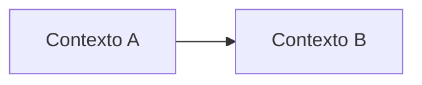

# 1. Modelagem do domínio

## Bounded contexts

<!-- Liste os contextos delimitados envolvidos na Garantia de Prazo. Cada requisito
deve ter exatamente um contexto responsável. -->

| Contexto | Responsabilidade | Requisitos sob sua responsabilidade |
|---|---|---|
Garantia de Prazo (novo, core)|	Avaliar cada entrega confirmada, aplicar a política do tipo de cliente, decidir o crédito, garantir idempotência e manter o saldo|	RF01, RF02, RF03, RF04, RF05, RF09, RNF02
Pedidos, Frete e Telemetria (fornecedores)|	Pedidos publica a confirmação de entrega de forma durável. Frete fornece prazo e valor. Telemetria fornece paradas e posição|	RF01, RF05, RF10, RNF01
Faturamento|	Emitir a nota de crédito com número sequencial único	|RF06, RNF03
Notificações (com ACL do parceiro WhatsApp)|	Entregar por e-mail ou WhatsApp, com 3 retentativas e falha final registrada|	RF07, RF08
Portal do Cliente|	Exibir posição, previsão e saldo ao vivo|	RF10

## Mapa de contexto

<!-- Mostre como os contextos se relacionam: quem consome dados de quem e em que
direção. Pode usar Mermaid, que o GitHub renderiza. -->

## Entidades e agregados

<!-- Para cada agregado: a raiz, as entidades e objetos de valor que ele contém e a
regra de consistência que ele protege. -->

| Agregado | Raiz | Entidades e objetos de valor | Regra que protege |
|---|---|---|---|
Avaliação de Garantia (Garantia de Prazo)|	AvaliacaoDeGarantia (id = entregaId)|	VO Atraso, VO PrazoPrometido, VO ValorFrete, VO Decisao (ComCredito(valor) ou SemCredito(motivo)), enum MotivoSemCredito|	No máximo uma avaliação, e portanto um crédito, por entrega (RF09). Decisão imutável. Crédito nunca acima do teto (R$ 500 Varejo, R$ 2.000 Corporativo)
Conta de Crédito (Garantia de Prazo)|	ContaDeCredito (por cliente)	|Entidade Lancamento, VO Saldo|	Saldo é a soma dos lançamentos. Um lançamento nunca entra duas vezes
Nota de Crédito (Faturamento)|	NotaDeCredito|	VO NumeroNota, VO Valor, referência à avaliação|	Número vem de sequence do banco, único e nunca reutilizado (RF06, RNF03). Uma nota por avaliação
Notificação (Notificações)|	Notificacao|	Entidade Tentativa, enum Estado (Pendente, Enviada, FalhaFinal), VO Canal|	Até 3 retentativas. Falha final persistida e visível, nunca descartada (RF08)
Entrega (Pedidos)|	Entrega|	Entidade ConfirmacaoDeEntrega, VO TipoCliente|	Confirmação publicada de forma durável, sem perda (RNF01)
Registro de Ausência (Telemetria)|	RegistroDeAusencia|	Entidade AmostraDePosicao	|Amostras podem faltar. Prova exige parada a até 200 m por pelo menos 10 min (RF05)

## Linguagem ubíqua

<!-- Termos do negócio com a definição que a equipe vai usar no código. Ex.: atraso,
crédito, teto, ausência comprovada. -->

| Termo | Definição |
|---|---|
Garantia de Prazo|	Compromisso de conceder crédito automático quando a entrega atrasar
Prazo prometido|	Data e hora de entrega informada pelo Frete ao cliente
Confirmação de entrega|	Registro de que a mercadoria foi entregue. Gatilho da avaliação
Atraso|	Horas entre o prazo prometido e a confirmação. Se for ≤ 0, não há atraso
Faixa de atraso|	Intervalo de atraso ligado a um percentual do frete. Limite superior inclusivo (2 h exatas ainda é sem crédito)
Tipo de cliente|	Varejo, Corporativo ou Cortesia. Define a política de crédito
Política de crédito|	Regra que transforma atraso e valor do frete em crédito para um tipo de cliente
Cliente Cortesia|	Frete zero. Não recebe crédito, mas é notificado do atraso
Crédito|	Percentual do frete em reais, limitado ao teto
Teto de crédito|	Máximo por pedido: R$ 500 (Varejo) e R$ 2.000 (Corporativo)
Ausência comprovada|	Veículo parado a até 200 m do endereço por pelo menos 10 min antes do registro da ausência. Elimina o crédito
Amostra de posição|	Leitura de telemetria a cada 30 s, sujeita a perda
Avaliação de garantia|	Resultado único de uma entrega: com crédito, ou sem crédito e o motivo
Idempotência|	Processar a mesma confirmação duas vezes equivale a processar uma. Chave: entregaId
Nota de crédito|	Documento emitido pelo Faturamento para cada crédito concedido
Número da nota|	Identificador sequencial, único e nunca reutilizado
Saldo de créditos|	Soma dos créditos do cliente, exibida no Portal
Canal preferido|	E-mail ou WhatsApp, escolhido pelo cliente
Falha final|Notificação que esgotou as 3 retentativas. Registrada e visível
