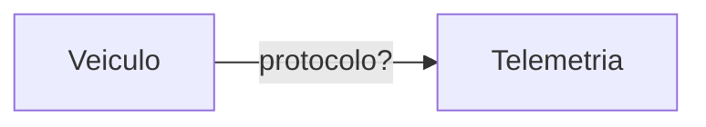

# 2. Arquitetura

## Diagrama dos serviços

<!-- Desenhe os serviços e cada comunicação entre eles. Toda seta indica o protocolo
usado (TCP, UDP, HTTP, SSE, ...). -->



## Protocolo de cada comunicação

| Origem | Destino | Protocolo | Requisito atendido | Justificativa |
|---|---|---|---|---|
Veículo|	Telemetria	|MQTT com QoS 0 (ou UDP)|	RNF01	|A amostra de 30 s tolera perda. Um protocolo leve, sem confirmação, evita custo e retransmissão desnecessários. A próxima amostra substitui a perdida
Pedidos|	Broker → Garantia	|Fila durável (RabbitMQ ou Kafka), com publisher confirm, ack manual e padrão outbox|	RNF01, RF09|	A confirmação de entrega não pode ser perdida. A mensagem é gravada no banco do Pedidos junto com a mudança de estado e só então publicada. Se o consumidor cair, o broker reentrega
Garantia|	Frete|	HTTP/REST síncrono (com timeout e retry)|	RF01|	A consulta é pontual, de leitura e precisa de resposta imediata para calcular o atraso
Garantia|	Telemetria|	HTTP/REST síncrono|	RF05|	Consulta de paradas na janela de 10 min antes do registro de ausência
Garantia|	Faturamento|	HTTP/REST com cabeçalho Idempotency-Key = avaliacaoId	|RF06, RF09, RNF02	|O retry após falha de rede não duplica a nota. A resposta traz o número emitido
Garantia|	Broker → Notificações|	Fila durável com ack|	RF07, RF08	|Desacopla a Garantia dos canais. A mensagem fica guardada se Notificações estiver fora
Notificações|	Serviço de e-mail|	SMTP (ou API do serviço atual)|	RF07|	Mantém o serviço existente
Notificações	|Parceiro WhatsApp|	HTTPS/REST, atrás de um Adapter	|RF07	|A API do parceiro tem formato diferente. O Adapter traduz sem vazar o formato para o domínio
Telemetria, Garantia, Frete|	BFF do Portal	|HTTP/REST e eventos internos|	RF10|	O BFF agrega posição, previsão e saldo em um só contrato para o front
BFF|	Portal (React)|	WebSocket ou SSE|	RF10|	Atualização ao vivo sem polling. SSE basta, pois o fluxo é só do servidor para o navegador

## Padrões de projeto

<!-- Para cada ponto da solução onde um padrão se aplica: qual padrão, qual problema
ele resolve e qual requisito motiva a escolha. -->

| Ponto da solução | Padrão | Requisito | Justificativa |
|---|---|---|---|
Cálculo do crédito por tipo de cliente	|Strategy (PoliticaVarejo, PoliticaCorporativo, PoliticaCortesia)|	RF02, RF03|	Cada tipo tem uma regra própria e intercambiável
Escolha da política|	Registry (mapa TipoCliente → Política)|	RF04	|Um novo tipo é uma nova classe e um novo registro, sem alterar as existentes (Open/Closed)
Canais de notificação|	Adapter sobre a interface CanalDeNotificacao|	RF07|	A API do parceiro WhatsApp fica isolada. Trocar ou acrescentar canal não afeta o restante
Integração com Frete e Telemetria|	Anti-Corruption Layer (Facade + tradutor)|	RF01, RF05|	O modelo dos outros serviços não contamina o domínio da Garantia
Entrega do evento sem perda|	Transactional Outbox	|RNF01|	Garante que o estado do pedido e a publicação do evento não se separam
Duplicidade de confirmação|	Idempotent Receiver	|RF09	|O mesmo entregaId processado duas vezes gera um só resultado
Falha de envio|		Retry (3 tentativas, com backoff) + Dead Letter Queue	|	RF08	|	A falha final fica persistida e visível, nunca descartada
Crédito e nota de crédito|		Saga orquestrada (ou reprocessamento)|		RF06, RNF02|		Se o crédito foi decidido e a nota falhou, o estado intermediário é retomado, não perdido
Reação aos eventos|		Publish/Subscribe|		RF07, RF10|		Os produtores não conhecem os consumidores
Acesso a dados|		Repository|		RF09|		Isola a persistência e permite testar o domínio sem banco

### Ponto onde a dupla decidiu não aplicar padrão

Padrão descartado: Saga com coordenador próprio entre Garantia e Faturamento. Há só dois participantes e um passo compensável (reenviar o comando). A AvaliacaoDeGarantia guarda o estado (Decidida, NotaEmitida), e um reprocessador reenvia o comando das avaliações Decidida há mais de 1 min. Como o comando usa Idempotency-Key = avaliacaoId, repetir é seguro. Um coordenador adicionaria serviço e testes sem ganho. Revisar se surgirem mais passos (estorno, aprovação).
## Confirmação de entrega duplicada (RF09)

A garantia fica no banco da Garantia: a tabela de avaliações tem entregaId como chave primária. O consumidor tenta inserir; se violar a chave, a entrega já foi processada, então não gera novo crédito e dá ack. Avaliação, lançamento e comando de nota entram na mesma transação. Funciona mesmo com duas cópias simultâneas em instâncias diferentes. O Faturamento também tem unicidade na referência à avaliação.
## Numeração das notas de crédito (RF06 e RNF03)
O número vem de uma sequence do banco do Faturamento, com restrição UNIQUE. A aplicação nunca calcula o número (nada de contador em memória ou MAX+1). A sequence é atômica entre instâncias e sobrevive a reinícios. Limitação assumida: transação desfeita pode deixar lacuna, e o requisito pede unicidade, não continuidade. Teste: 1.000 emissões concorrentes, todos os números distintos.

## Execução em contêineres (RNF04)


```yaml
services:services:
  broker:
    image: rabbitmq:3-management
    ports: ["5672:5672", "15672:15672"]
    healthcheck:
      test: ["CMD", "rabbitmq-diagnostics", "ping"]
      interval: 10s
      retries: 5

  db-pedidos:
    image: postgres:16
    environment: { POSTGRES_DB: pedidos, POSTGRES_PASSWORD: dev }
  db-garantia:
    image: postgres:16
    environment: { POSTGRES_DB: garantia, POSTGRES_PASSWORD: dev }
  db-faturamento:
    image: postgres:16
    environment: { POSTGRES_DB: faturamento, POSTGRES_PASSWORD: dev }

  pedidos:
    build: ./pedidos
    ports: ["8081:8080"]
    depends_on:
      broker: { condition: service_healthy }
      db-pedidos: { condition: service_started }

  frete:
    build: ./frete
    ports: ["8082:8080"]

  telemetria:
    build: ./telemetria
    ports: ["8083:8080", "1883:1883"]

  faturamento:
    build: ./faturamento
    ports: ["8085:8080"]
    depends_on: [db-faturamento]

  garantia:
    build: ./garantia
    ports: ["8084:8080"]
    depends_on:
      broker: { condition: service_healthy }
      db-garantia: { condition: service_started }
      frete: { condition: service_started }
      telemetria: { condition: service_started }
      faturamento: { condition: service_started }

  parceiro-whatsapp-mock:
    build: ./mocks/whatsapp
    ports: ["8090:8080"]

  notificacoes:
    build: ./notificacoes
    ports: ["8086:8080"]
    depends_on:
      broker: { condition: service_healthy }
      parceiro-whatsapp-mock: { condition: service_started }

  portal-bff:
    build: ./portal-bff
    ports: ["8080:8080"]
    depends_on: [telemetria, garantia, frete]

  portal:
    build: ./portal
    ports: ["3000:3000"]
    depends_on: [portal-bff]
```
